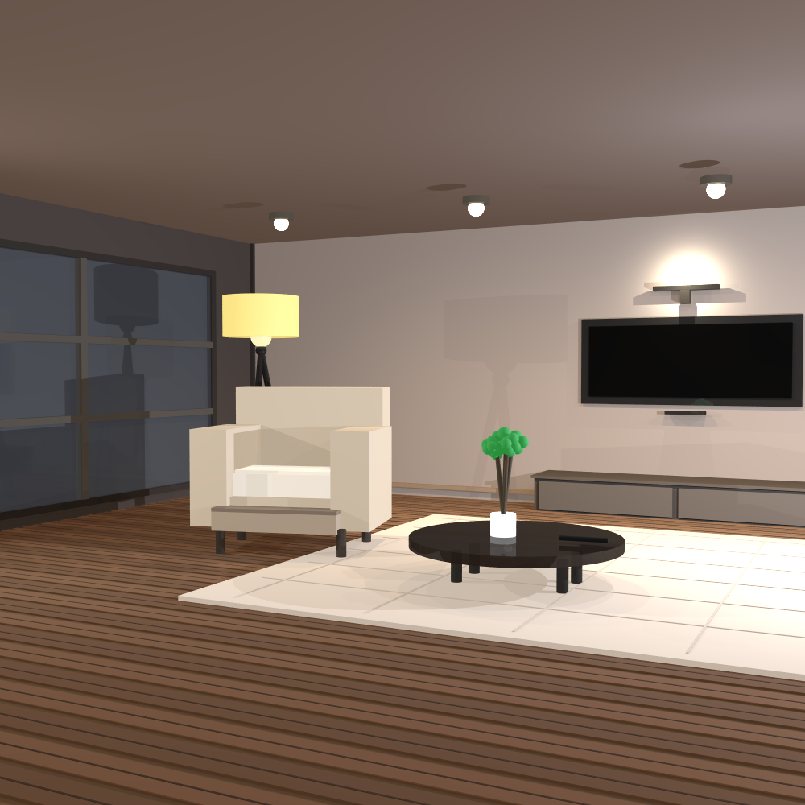

# 🎯 Ray Tracing Engine – Stage 10 Performance Report

Advanced 3D Ray Tracing Engine built from scratch in Java as part of the **Software Engineering** course at Tal
Institute.

---

## 👥 Project Team

* **Sara Alvesson**
* **Shira Shoval**
* **Instructor:** Yair Goldstein

---

## 📌 Introduction and Purpose

This report documents the performance measurements and optimization integrations for **Stage 10** of the mini-project.

In this stage, the impact of two core optimizations on rendering performance was evaluated:

1. **Multithreading:** Distributing the pixel color calculation across multiple CPU cores in parallel.
2. **Spatial Acceleration (BVH/CBR – Bounding Volume Hierarchy / Container Bounding Box):** Automatic construction of a
   bounding body hierarchy to preemptively discard entire groups of objects that the ray does not traverse, saving
   expensive algebraic intersection calculations.

> **Note:** Every benchmark was executed using the exact same scene, camera settings, materials, geometries, light
> sources, rendering quality, and image resolution to ensure a fair, consistent, and accurate comparison.

---

## 🛠️ Implementation Overview

### 1. Rendering Management (`Camera` Class)

The `Camera` class manages the main pixel traversal loop, ray generation, color calculation against light sources, and
output to the `ImageWriter`.

In this stage, dynamic support for multiple rendering modes was added:

* **Single-Threaded:** Rendering pixel-by-pixel serially.
* **Parallel Streams:** Utilizing Java's native parallel stream capabilities.
* **Smart Raw Threads:** Dedicated management using a `PixelManager`, where each thread continuously requests the next
  available pixel to process, maximizing CPU utilization.

Both the **multithreading modes** and the **BVH/CBR acceleration** can be enabled or disabled directly from the test
cases through the Camera API without modifying the renderer implementation.

### 2. Acceleration Algorithm (CBR/BVH)

Every geometric object or geometry group (`Geometries`) is assigned a Bounding Box.

Before performing expensive algebraic ray-object intersection calculations, a fast Bounding Box intersection test is
executed. If the ray misses the Bounding Box, the entire geometry or hierarchy is skipped.

The project implements **automatic BVH hierarchy construction**, reducing the search complexity from approximately **O(
N)** to **O(log N)**.

---

## 📐 Scene Description and Rendering Settings

The benchmark scene represents a **rich and complex living room** including:

* Floor
* Walls
* Large window
* Detailed armchair
* Coffee table
* Plant
* Television
* Floor lamp
* Ceiling spotlights

The **Stage 9 image-quality improvements — Soft Shadows and Anti-Aliasing** remained enabled throughout all benchmark
executions to ensure that the acceleration techniques were evaluated under realistic rendering conditions.

### Key Rendering Parameters

| Parameter                 | Value / Setting                         |
|:--------------------------|:----------------------------------------|
| **Resolution**            | 1000 × 1000 pixels                      |
| **View Plane Size**       | 740                                     |
| **View Plane Distance**   | 900                                     |
| **Anti-Aliasing Samples** | 5 primary rays per pixel                |
| **Soft Shadow Samples**   | 8 samples per light source              |
| **Active Lighting Types** | DirectionalLight, PointLight, SpotLight |
| **Optical Effects**       | Shadows, Refraction, Reflection         |

---

## 📊 Measurement Results and Performance Analysis

Below is the summary of runtime measurements for the four mandatory benchmark configurations.

### ⏱️ Performance Summary

|  Run  | Measurement Mode                       | BVH Build Overhead (sec) | Total Render Time (sec) | Render Time  |
|:-----:|:---------------------------------------|:------------------------:|:-----------------------:|:------------:|
| **1** | 🛑 No Acceleration & No Multithreading |            —             |     **10,513.8838**     | **02:55:14** |
| **2** | 🧵 Multithreading Only                 |            —             |     **2,644.1064**      | **00:44:04** |
| **3** | 🚀 BVH/CBR Only                        |      **0.0131201**       |     **3,266.1263**      | **00:54:26** |
| **4** | 🌟 BVH/CBR + Multithreading            |       **0.012786**       |      **471.2895**       | **00:07:51** |

---

## 📈 Speedup Factors Calculation

The measured speedups are:

* **Multithreading only**

  $$\frac{10513.8838}{2644.1064}\approx3.98\times$$

* **BVH/CBR only**

  $$\frac{10513.8838}{3266.1263}\approx3.22\times$$

* **Overall system improvement**

  $$\frac{10513.8838}{471.2895}\approx22.31\times$$

---

## 🖼️ Rendering Gallery

### Visual Comparison – Soft Shadows without Anti-Aliasing

The image below was rendered **with Soft Shadows enabled but without Anti-Aliasing**.
It is placed first to clearly demonstrate the visual contribution of the Anti-Aliasing implementation introduced in
Stage 9.


---

### Run 1 – No Optimizations


---

### Run 2 – Multithreading Only


---

### Run 3 – BVH/CBR Acceleration Only


---

### Run 4 – Full Optimization



---

## 💻 Full Console Output (JUnit Log)

```text
========================================
Image: stage10_1_noAcceleration_flattened_noThreads
Scene Structure Mode: FLATTENED
CBR Acceleration Checks: DISABLED
Multithreading Count Mode: 0
Pure Rendering Execution Time: 10513.8837967 seconds
========================================

========================================
Image: stage10_2_noAcceleration_flattened_withThreads
Scene Structure Mode: FLATTENED
CBR Acceleration Checks: DISABLED
Multithreading Count Mode: -2
Pure Rendering Execution Time: 2644.1063747 seconds
========================================

========================================
Image: stage10_11_withCBR_automaticHierarchy_noThreads
Scene Structure Mode: AUTOMATIC_HIERARCHY
CBR Acceleration Checks: ENABLED
Multithreading Count Mode: 0
Automatic BVH Tree Build Overhead: 0.0131201 seconds
Pure Rendering Execution Time: 3266.1262642 seconds
========================================

========================================
Image: stage10_12_withCBR_automaticHierarchy_withThreads
Scene Structure Mode: AUTOMATIC_HIERARCHY
CBR Acceleration Checks: ENABLED
Multithreading Count Mode: -2
Automatic BVH Tree Build Overhead: 0.012786 seconds
Pure Rendering Execution Time: 471.2894978 seconds
========================================
```

---

## 🎯 Summary and Conclusions

The integration of **Smart Multithreading** together with **Automatic CBR/BVH Hierarchy** significantly improved the
rendering performance of the ray tracing engine.

Performance measurements demonstrated that both optimization techniques complement each other effectively, achieving an
overall **22.31× speedup** while preserving identical visual quality across all benchmark configurations.

The results confirm that:

* ✅ Smart Multithreading efficiently utilizes multiple CPU cores.
* ✅ Automatic CBR/BVH Hierarchy dramatically reduces unnecessary ray-object intersection tests.
* ✅ The combination of both optimizations provides the best rendering performance.
* ✅ The final rendered image remains visually identical despite the substantial reduction in rendering time.

Overall, the project demonstrates how combining advanced rendering techniques with efficient optimization algorithms
enables high-quality image generation while dramatically reducing execution time.
